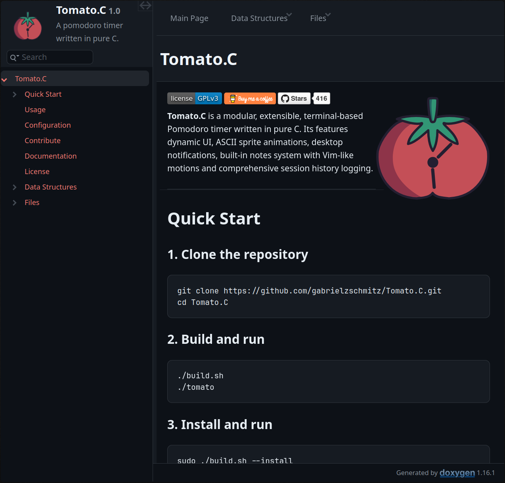

# Tomato.C


<a href="./LICENSE"></a>
<a href="https://www.buymeacoffee.com/gabrielzschmitz" target="_blank"></a>
<a href="https://github.com/gabrielzschmitz/Tomato.C"></a>

**Tomato.C** is a modular, extensible, terminal-based Pomodoro timer written in
pure C. Its features dynamic UI, ASCII sprite animations, desktop
notifications, built-in notes system with Vim-like motions and comprehensive
session history logging.

---

## Installation

Choose the installation method that best fits your needs. The **install
script** is the quickest option for Linux and macOS. **Building from source**
is ideal if you want to customize or contribute.

<details>
<summary>Quick install script</summary>

```bash
curl -sSL https://raw.githubusercontent.com/gabrielzschmitz/Tomato.C/main/install.sh | bash
```

</details>

<details>
<summary>Build from source</summary>

```bash
git clone https://github.com/gabrielzschmitz/Tomato.C.git
cd Tomato.C
./build.sh
# And/or
./install.sh
```

By default the build uses [gcc](https://gcc.gnu.org/). To use
[tcc](https://bellard.org/tcc) (Tiny C Compiler) or [zig](https://ziglang.org)
as an alternative, pass it on the command line:

```bash
CC=tcc ./build.sh
# And/or
CC=tcc ./install.sh
```

```bash
CC="zig cc" ./build.sh
# And/or
CC="zig cc" ./install.sh
```

Alternatively for a more permanent change, edit `CC = gcc` in `build/config.mk`.

</details>

<details>
<summary>macOS with Homebrew</summary>

Install Xcode Command Line Tools and [Homebrew](https://brew.sh). The quick
installer above detects Homebrew and installs `ncurses` automatically:

```bash
xcode-select --install
curl -sSL https://raw.githubusercontent.com/gabrielzschmitz/Tomato.C/main/install.sh | bash
```

To build without installing system-wide, install `ncurses` and build from a
checkout:

```bash
brew install ncurses
git clone https://github.com/gabrielzschmitz/Tomato.C.git
cd Tomato.C
./build.sh
```

</details>

<details>
<summary>Uninstall</summary>

From local repo:

```bash
sudo ./install.sh --uninstall
```

Via curl:

```bash
curl -sSL https://raw.githubusercontent.com/gabrielzschmitz/Tomato.C/main/install.sh | bash -s -- --uninstall
```

</details>

---

## Usage

Pomodoro controls and navigation are handled via keyboard shortcuts and mouse
input. To get help with the keybinds press `?`/`F1` at anytime!

### Command-line reference

```text
tomato [--help] [--version]
tomato [-loop true|false] -t [nerd-icons|emojis|ascii|no-icons]
tomato -h [overview|today]
```

- `tomato -t` streams timer status while the app runs.
- `tomato -loop false -t` prints one timer status and exits.
- `tomato -t ascii` streams status without requiring Nerd Fonts.
- `tomato -h` or `tomato -h overview` prints history overview.
- `tomato -h today` prints today's sessions.
- `tomato --help` and `tomato --version` print command help and version.

Timer output requires `logging.timer_log = true`. History commands require
`logging.history_log = true`.

### Keyboard overview

- Main menu: use Up/Down or `j`/`k`; press Enter to choose an item.
- Global: press `?` or F1 for in-app help. In default mode, `q`, Escape, or
  Ctrl-C opens quit confirmation. Notes editing modes use Escape to change mode.
- Pomodoro: `p` pauses or resumes; `s` skips a step; Ctrl-R opens reset options;
  `m` returns to main menu.
- Notes: `j`/`k` moves through notes; `h`/`l` navigates pages; `i` enters insert
  mode; Escape returns to default mode; `u` undoes and Ctrl-R redoes.
- Mouse clicks and wheel events also work in supported menus and dialogs.

Keybindings are configurable. In-app help shows active bindings for current
scene and mode.

### Status-bar examples

Configure status-bar modules by position in `config.toml`:

```toml
[visual.status_bar.modules]
left = ["InputMode", "RealTime"]
center = ["CurrentStatus", "Streak"]
right = ["Scene", "LineColumn"]
```

Available modules: `InputMode`, `RealTime`, `Scene`, `CurrentStatus`,
`LineColumn`, `Streak`, `Date`, `Weekday`, `TerminalSize`, and `Icons`.
Module names are case-sensitive. The sample configuration shows default layout.

<p align="center">
  
</p>
<p align="center">
  <em>
  Tomato.C combines modern productivity features with a clean, retro-inspired
  terminal interface.
  </em>
</p>

---

## Configuration

Tomato.C uses a _toml_ configuration file. When installed via `install.sh`, a
fully commented sample config is automatically created at
`~/.config/tomato/config.toml`.

All available options are documented directly in the file, including timer
durations, status bar modules, notifications, animations, keybindings, and
other general settings.

Configuration loads once at startup. Built-in defaults load first, then
`/etc/tomato/config.toml`, then user configuration. User values override system
values; omitted values keep their current defaults or lower-priority values.

User configuration path precedence:

1. `$TOMATO_CONFIG_DIR/config.toml` when `TOMATO_CONFIG_DIR` is absolute.
2. `$XDG_CONFIG_HOME/tomato/config.toml`.
3. `$HOME/.config/tomato/config.toml`.

`TOMATO_STATE_DIR` selects state directory when absolute. Otherwise Tomato.C
uses `$XDG_STATE_HOME/tomato` when `XDG_STATE_HOME` is absolute, then
`$HOME/.local/state/tomato`. State files
include `pomodoro.bin`, `notes.log`, and `errors.log`; `logging.*_log` options
can override their paths. `TOMATO_RUNTIME_DIR` selects timer-socket directory;
otherwise `XDG_RUNTIME_DIR` or state directory is used. Only absolute values
for `TOMATO_CONFIG_DIR`, `TOMATO_STATE_DIR`, and `TOMATO_RUNTIME_DIR` are honored.
If no home directory is available, Tomato.C falls back to a private
`/tmp/tomato-<uid>` directory. The development shell redirects paths under
`.tmp/`.

### Troubleshooting

- **Linux desktop notifications:** install and run a notification daemon that
  implements `org.freedesktop.Notifications`, such as `dunst`. Check that your
  session D-Bus is active and test with `notify-send`. Set `notifications.enabled`
  to `true`.
- **WSL notifications:** set `misc.wsl = true` and ensure `notify-send` is
  available through WSL's desktop integration. macOS uses `osascript`; allow
  notifications for your terminal in System Settings.
- **Notification sound:** set `notifications.sound = true` and check
  `notifications.sound_volume` and system output device. Sound is disabled in
  WSL. Desktop notifications and sound are separate settings.
- **Missing glyphs:** `visual.icons = "nerd-icons"` requires a Nerd Font in your
  terminal. Use `"emojis"` with a font that supports emoji, or `"ascii"` for
  portable text symbols.
- **Small terminal:** enlarge the terminal until the displayed minimum width
  and height are met. The minimum depends on selected animations and icon set.

---

## Documentation

Complete API and developer documentation is generated with **Doxygen**.
For design details, see [Architecture](ARCHITECTURE.md); for build, test, and
contribution steps, see [Contributing](CONTRIBUTING.md).

<p align="center">
  
</p>
<p align="center">
  <em>
  Doxygen-generated API documentation for Tomato.C.
  </em>
</p>

Generate the documentation locally:

```bash
cd docs
./generate.sh
$BROWSER output/html/index.html
```

---

## Contribute

Feel free to contribute to the project, the requirements are to follow
[Conventional Commits](https://www.conventionalcommits.org/en/v1.0.0), follow
[DOXYGEN](https://www.doxygen.nl/index.html) style of documenting code and use
`.clang-format` to format the files.

### Development

A [Nix](https://nixos.org) package, flake, and development shell are included
for reproducible builds and tooling.

Build and run the packaged binary:

```bash
nix build .#    # builds into result/bin/tomato
nix run   .#    # runs the binary
nix build .#tcc # builds with TinyCC
nix build .#zig # builds with Zig's C compiler
nix flake check # builds and tests GCC, TinyCC, and Zig variants
```

Enter a development shell (flake or classic `nix-shell`):

```bash
nix develop # flake-based shell
nix-shell   # classic (non-flake) shell
```

The shell provides `gcc`, `make`, `pkg-config`, `ncurses`, `libnotify`, plus
`clang-format`, `bear`, `doxygen`, `tcc`, `zig`, and `valgrind`. It also keeps
Tomato.C's config, state, and runtime files under `.tmp/` in the repository
using `TOMATO_CONFIG_DIR`, `TOMATO_STATE_DIR`, and `TOMATO_RUNTIME_DIR`, so
running the development binary never touches your real config. The shell does
not override the `XDG_*` variables, leaving the rest of your environment
untouched. From inside it, build and test as usual:

```bash
./build.sh
./run_tests.sh
```

---

## License

This project is licensed under the GNU General Public License v3.0. See the
[LICENSE](./LICENSE) file for details.
